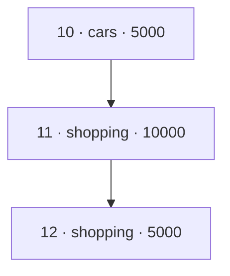
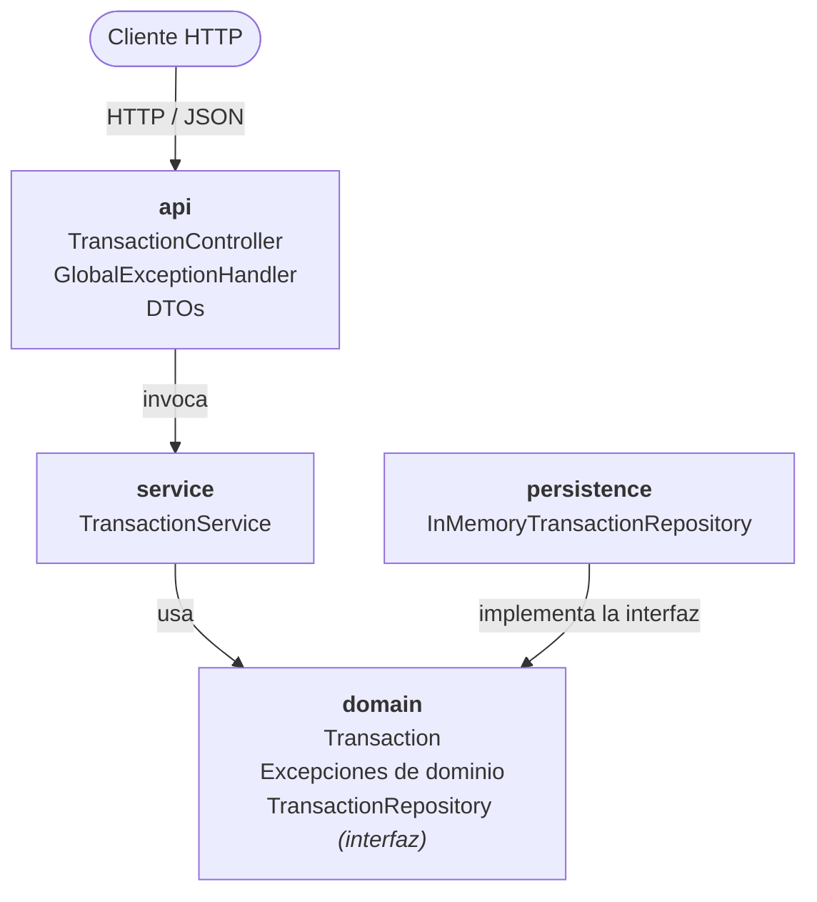

# Decisiones de diseño

Registro de las decisiones de diseño del servicio. Cada una incluye el **contexto**, la **decisión** y su **justificación**. Los requisitos del servicio están en [`REQUIREMENTS.md`](REQUIREMENTS.md).

---

## 1. Suma de una transacción: la transacción y todos sus descendientes

**Contexto.** Las transacciones se vinculan con `parent_id`. `GET /transactions/sum/{id}` devuelve la suma de las transacciones conectadas transitivamente con `{id}`.

**Decisión.** `sum(id)` = `amount(id)` + `amount` de **todos sus descendientes** (hijos, nietos, etc.). Los ancestros no se incluyen.

**Modelo.** Cada transacción tiene como mucho un padre y puede tener muchos hijos, así que las transacciones forman un **bosque de árboles**. La suma de una transacción es la suma del **subárbol** que la tiene como raíz.



| Consulta | Transacciones sumadas | Resultado |
|---|---|---|
| `GET /transactions/sum/10` | 10 + 11 + 12 | 20000 |
| `GET /transactions/sum/11` | 11 + 12 | 15000 |
| `GET /transactions/sum/12` | 12 | 5000 |

**Justificación.** Es el comportamiento que define el escenario de ejemplo de la API: `sum/11` da 15000, así que no incluye a su padre 10.

---

## 2. Las transacciones son inmutables: un id existente devuelve `409 Conflict`

**Decisión.** `PUT /transactions/{id}` crea una transacción nueva. Si `{id}` ya existe, responde `409 Conflict` y no modifica nada.

**Justificación.**

- `transaction_id` identifica a una transacción **nueva**.
- Un registro financiero no se edita: si hay que corregirlo, se registra otra transacción.
- Mantiene simples los índices, porque el tipo y el padre de una transacción nunca cambian.

**Idempotencia.** PUT sigue siendo idempotente: repetir la misma request deja el servidor en el mismo estado. Lo que cambia es la respuesta (`200` la primera vez, `409` las siguientes), y la idempotencia se refiere al estado, no a la respuesta.

---

## 3. El padre tiene que existir: un `parent_id` inexistente devuelve `404 Not Found`

**Decisión.** Si la request trae `parent_id` y esa transacción no existe, se responde `404` con un `ProblemDetail` que aclara que el recurso faltante es el **padre**.

**Consecuencia: no pueden existir ciclos.** Las decisiones 2 y 3 juntas garantizan que el grafo sea siempre un bosque:

1. Un hijo sólo se puede crear si su padre ya existe, así que todo hijo es **más nuevo** que su padre.
2. Una transacción no se modifica, así que su `parent_id` nunca puede pasar a apuntar a una transacción más nueva.
3. Todas las referencias `hijo → padre` apuntan hacia transacciones más viejas, y con eso no se puede volver al punto de partida.

Esto incluye el caso `PUT /transactions/5 { "parent_id": 5 }`: al validar, la transacción 5 todavía no existe y se responde `404`. Si 5 ya existía, se responde `409`. **No hace falta código de detección de ciclos.**

---

## 4. Montos como `double`

**Decisión.** `amount` y `sum` se representan como `double`, tal como los define el contrato de la API.

**Limitaciones conocidas.**

- `double` representa los números en binario, y muchos decimales no tienen representación exacta. Por ejemplo, `0.1 + 0.1 + 0.1` da `0.30000000000000004`. Los enteros hasta 2⁵³ sí se representan exactos.
- La suma se serializa como `20000.0`. En JSON es el mismo número que `20000`.
- JSON no admite `NaN` ni `Infinity`, así que esos valores no pueden entrar por la API.

---

## 5. Contrato HTTP

### `PUT /transactions/{id}`

| Caso | Respuesta |
|---|---|
| Transacción creada | `200 {"status":"ok"}` |
| `amount` o `type` faltan, o `type` está en blanco | `400` |
| JSON mal formado o tipos inválidos (`"amount": "abc"`) | `400` |
| `{id}` no numérico o fuera del rango de `long` | `400` |
| `{id}` o `parent_id` menor o igual a 0 | `400` |
| `parent_id` inexistente | `404` |
| `{id}` existente | `409` |
| `parent_id` ausente o `null` | Se crea como raíz |
| `amount` en cero o negativo | Se acepta |
| Campos desconocidos en el body | Se ignoran |

**Orden de validación:** `400` → `404` → `409`. Primero se valida que la request sea correcta (en el controller) y después que sea compatible con el estado actual (en el service).

### `GET /transactions/types/{type}`

| Caso | Respuesta |
|---|---|
| Hay transacciones del tipo | `200 [10, 11, ...]` en orden ascendente |
| No hay transacciones del tipo | `200 []` |

- El tipo es **case-sensitive** (`cars` ≠ `Cars`).
- El orden ascendente hace que la respuesta sea determinística.

### `GET /transactions/sum/{id}`

| Caso | Respuesta |
|---|---|
| La transacción existe | `200 {"sum": 20000.0}` |
| La transacción no existe | `404` |
| `{id}` no numérico o menor o igual a 0 | `400` |

### Ids positivos

Los ids de las transacciones (`{id}` y `parent_id`) son enteros **mayores a 0**.

- Un id menor o igual a 0 nunca puede existir, así que se trata como un dato **mal formado** (`400`), igual que un id no numérico. No es un recurso inexistente (`404`).
- La regla aplica en todos los endpoints que reciben un id: **`400` si el id es inválido, `404` si es válido pero no existe**.
- La ausencia de padre se representa con `parent_id` ausente o `null`, nunca con un valor especial como `0`.

### Montos en cero o negativos

`amount` acepta cualquier valor numérico, incluidos `0` y los negativos. Como las transacciones son inmutables (decisión 2), una corrección se registra con otra transacción, y para revertir un monto hace falta un monto negativo.

### Colección vacía vs. recurso inexistente

- `types` devuelve una **colección**. Una colección sin elementos es una respuesta válida: `200 []`.
- `sum` consulta **un recurso individual**. Si no existe, la respuesta es `404`. Devolver `0` haría indistinguibles "la transacción no existe" y "la transacción existe y su suma es 0".

### Formato de errores

Los errores usan `ProblemDetail` (RFC 9457), que Spring incluye de fábrica:

```json
{
  "detail": "Parent transaction 999 does not exist",
  "status": 404,
  "title": "Not Found"
}
```

---

## 6. Stack

| Componente | Elección | Justificación |
|---|---|---|
| Lenguaje | Java 21 | Versión LTS. Los `record` modelan el dominio y los DTOs sin código repetitivo |
| Framework | Spring Boot 4.2.x | Versión estable actual. Incluye Spring Framework 7, Tomcat 11 embebido, Jackson 3 y JUnit 6 |
| Build | Maven con wrapper | Estándar y explícito. `./mvnw` funciona sin instalar Maven |
| Boilerplate | Sin Lombok | Los `record` ya generan constructores, accessors, `equals`, `hashCode` y `toString` |

---

## 7. Arquitectura en capas con puertos y adaptadores



**Estructura.** El servicio se organiza en cuatro paquetes: `api`, `service`, `domain` y `persistence`. Para la persistencia aplica el patrón de **puertos y adaptadores** (arquitectura hexagonal):

- **Puerto de salida:** `TransactionRepository` es una interfaz definida **en el dominio**. Expresa lo que el núcleo necesita del almacenamiento, en sus propios términos.
- **Adaptador de salida:** `InMemoryTransactionRepository` implementa ese puerto con estructuras en memoria.
- **Adaptador de entrada:** `TransactionController` traduce HTTP/JSON a llamadas al service, y `GlobalExceptionHandler` traduce las excepciones de dominio a respuestas HTTP.

**Justificación.**

- El service depende de la abstracción y no de la implementación (**inversión de dependencias**). Cambiar el almacenamiento no requiere tocar la lógica de negocio.
- Todas las dependencias apuntan hacia el núcleo, que no depende de Spring Web ni de la persistencia.
- Cada capa tiene una sola responsabilidad: `api` traduce HTTP, `service` aplica las reglas de negocio y `persistence` guarda e indexa.
- El controller invoca directamente a `TransactionService`, sin un puerto de entrada: hay un único caso de uso por operación y una única forma de entrada (HTTP), así que una interfaz intermedia no aportaría desacople real.

---

## 8. Almacenamiento en memoria y concurrencia

**Estructuras** (todas thread-safe):

```java
Map<Long, Transaction>   transactionsById       // ConcurrentHashMap: id → transacción
Map<String, Set<Long>>   idsByType              // ConcurrentHashMap + ConcurrentSkipListSet (ordenado)
Map<Long, Set<Long>>     childrenIdsByParentId  // ConcurrentHashMap + set concurrente: padre → hijos
```

**Índices.** Permiten responder sin recorrer todas las transacciones:

| Operación | Costo |
|---|---|
| Alta | O(log k) por la inserción en el índice ordenado |
| Ids por tipo | O(k), con k = cantidad de ids de ese tipo |
| Suma | O(s), con s = tamaño del subárbol |

**Alta atómica.** El repository expone `saveIfAbsent(transaction)`, implementado con `putIfAbsent`. Si dos requests concurrentes intentan crear el mismo id, exactamente una lo logra y la otra recibe `409`. Los índices se actualizan recién después de que el alta tuvo éxito.

**Verificación del padre sin locks.** El service verifica que el padre exista y después guarda. Como las transacciones nunca se borran ni se modifican, un padre que existía en la verificación sigue existiendo al guardar.

**Consistencia.** Entre el alta y la actualización de los índices hay una ventana de microsegundos en la que una consulta concurrente puede no ver todavía la nueva transacción. No viola ninguna regla de negocio.

---

## 9. Cálculo de la suma

**Decisión.** La suma se calcula en el momento de la consulta, con un recorrido en profundidad (DFS) **iterativo** sobre el índice `childrenIdsByParentId`, usando un `ArrayDeque` como pila.

**Justificación.**

- **Calcular al consultar:** el costo del alta no depende de la profundidad del árbol, y los índices son la única estructura que hay que mantener consistente.
- **Iterativo:** con recursión, una cadena larga de transacciones (por ejemplo, de 100.000 niveles) produciría `StackOverflowError`.
- **Sin registro de nodos visitados:** por la decisión 3 el grafo es siempre un árbol, así que cada nodo se visita una sola vez.

---

## 10. Testing

- **TDD:** cada funcionalidad sigue el ciclo `test:` (rojo) → `feat:` (verde) → `refactor:`, visible en el historial de commits.
- **El commit rojo compila:** incluye la firma mínima necesaria para que el test falle por la aserción. Así el historial nunca tiene un proyecto que no compila, y el rojo demuestra que el test verifica el comportamiento.
- **Unit:** el service se prueba con el repository en memoria real como *fake*, y el repository se prueba por separado. Sin Spring: corren en milisegundos.
- **Fakes antes que mocks:** el repository en memoria es rápido y determinístico. Usarlo real hace que los tests verifiquen el resultado (por ejemplo, "el segundo alta falla") y no detalles de implementación (por ejemplo, "se llamó a `saveIfAbsent`").
- **Integración:** `@SpringBootTest` + MockMvc contra el contexto completo de Spring. Cubre serialización, validación y manejo de errores.
- **Aislamiento:** Spring reutiliza el contexto entre tests, y con él el repository y sus datos. Los tests de integración usan `@DirtiesContext(classMode = AFTER_EACH_TEST_METHOD)` para arrancar cada test con un contexto nuevo. Cuesta unos segundos más de build, y a cambio ningún test depende del orden de ejecución ni de los datos de otro.
- **Aceptación:** el escenario de ejemplo de la API (transacciones 10, 11 y 12) es un test de integración literal.
- **Casos borde:** id duplicado (`409`), padre inexistente (`404`), ids no positivos (`400`), suma de una hoja, cadena profunda y tipo sin transacciones.

---

## 11. Docker

- **Multi-stage:** la etapa de build usa Maven + JDK 21, y la imagen final sólo incluye el **JRE 21** y el jar. Queda más chica y sin herramientas de build.
- **Usuario no-root** en runtime.
- **Sin tests en el build de la imagen** (`-DskipTests`): los tests corren en el CI en cada PR. Repetirlos al construir la imagen duplicaría el tiempo sin aportar información nueva.
- **Caché de capas:** se copia primero el `pom.xml` y se descargan las dependencias, y después el código. Un cambio en el código no vuelve a descargar las dependencias.

---

## 12. Integración continua

Un workflow de GitHub Actions ([`.github/workflows/ci.yml`](../.github/workflows/ci.yml)) corre `./mvnw verify` en cada PR a `main` y en cada push a `main`.

- JDK 21 Temurin, la misma distribución que la imagen Docker.
- Caché de dependencias de Maven.
- `concurrency` para cancelar corridas desactualizadas de la misma rama.
- `permissions: contents: read` (mínimo privilegio).
- Un PR sólo se mergea con el CI en verde.
