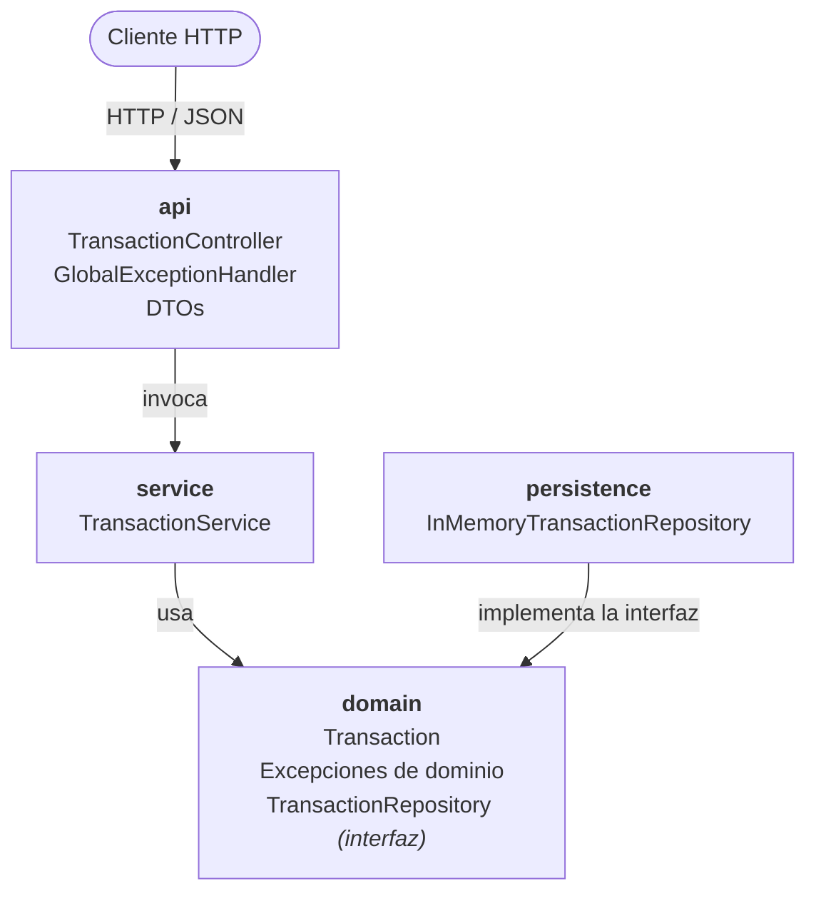
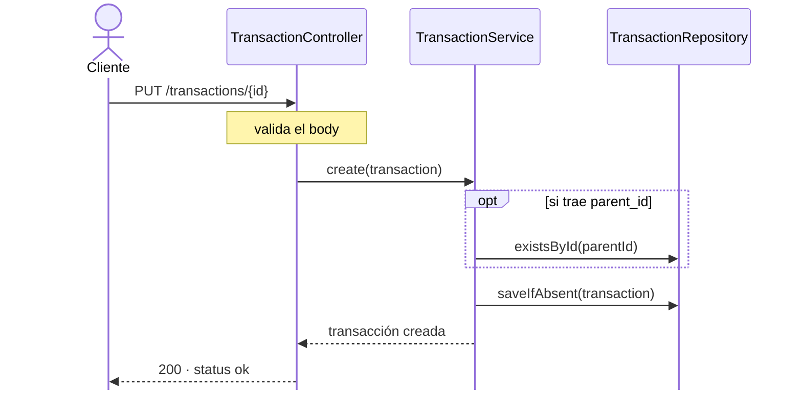
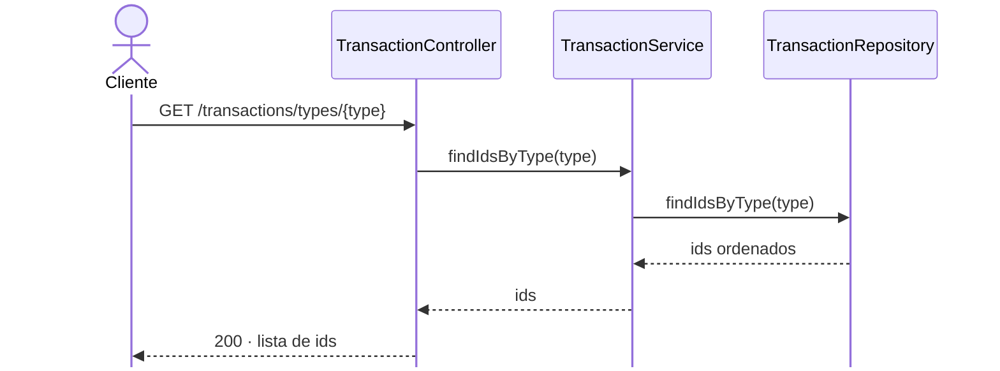
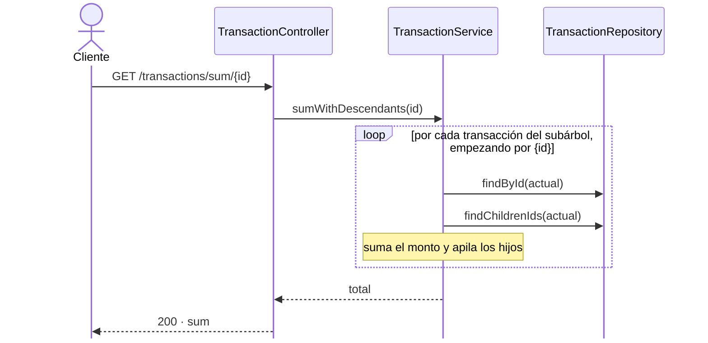

# Plan de implementación

Desarrollo incremental: **un PR por funcionalidad** y commits TDD dentro de cada PR. Las decisiones que justifican cada paso están en [`DECISIONS.md`](DECISIONS.md).

---

## Diseño de alto nivel

### Componentes

### Flujos

Los diagramas muestran el camino exitoso. Los errores se resuelven así:

| Endpoint | Error | Dónde se detecta | Respuesta |
|---|---|---|---|
| `PUT` | Body o id inválido | `TransactionController` (validación), antes de llamar al service | `400` |
| `PUT` | Padre inexistente | `TransactionService` → `ParentTransactionNotFoundException` | `404` |
| `PUT` | Id existente | `TransactionService` → `TransactionAlreadyExistsException` | `409` |
| `GET sum` | Id inválido | `TransactionController` (validación), antes de llamar al service | `400` |
| `GET sum` | Transacción inexistente | `TransactionService` → `TransactionNotFoundException` | `404` |

Las excepciones de dominio las traduce `GlobalExceptionHandler` a `ProblemDetail`.

#### `PUT /transactions/{id}`

#### `GET /transactions/types/{type}`

#### `GET /transactions/sum/{id}`

### Clases

| Paquete | Clase | Responsabilidad |
|---|---|---|
| `domain` | `Transaction` (record) | `id`, `amount`, `type`, `parentId` (`Long`, opcional) |
| `domain` | `TransactionRepository` | `saveIfAbsent`, `findById`, `existsById`, `findIdsByType`, `findChildrenIds` |
| `domain` | `TransactionAlreadyExistsException` | Id duplicado → `409` |
| `domain` | `TransactionNotFoundException` | Transacción consultada inexistente → `404` |
| `domain` | `ParentTransactionNotFoundException` | Padre inexistente → `404` |
| `service` | `TransactionService` | `create`, `findIdsByType`, `sumWithDescendants` |
| `persistence` | `InMemoryTransactionRepository` | Almacenamiento e índices thread-safe |
| `api` | `TransactionController` | Los 3 endpoints |
| `api` | `TransactionRequest` (record) | `amount`, `type`, `parentId` (`@JsonProperty("parent_id")`) + validaciones |
| `api` | `StatusResponse`, `SumResponse` (records) | `{"status":"ok"}` y `{"sum": ...}` |
| `api` | `GlobalExceptionHandler` | Excepciones de dominio → `ProblemDetail` |

### Contrato HTTP

| Request | Respuesta exitosa | Errores |
|---|---|---|
| `PUT /transactions/{id}` | `200 {"status":"ok"}` | `400` body o id inválido · `404` padre inexistente · `409` id existente |
| `GET /transactions/types/{type}` | `200 [ids en orden ascendente]` (o `[]`) | — |
| `GET /transactions/sum/{id}` | `200 {"sum": n}` | `400` id inválido · `404` transacción inexistente |

---

## PRs y commits

Cada PR sale de `main`, se escribe en español con el template **Qué / Cambios** y se mergea sólo con el CI en verde. Los mensajes de commit van en español (tipo y scope en inglés).

### PR 1 — `chore/project-setup`

- `chore: inicializa el proyecto Spring Boot 4.2 con Maven wrapper`
- `test: verifica que el contexto de la aplicación levante`
- `docs: agrega CLAUDE.md, requisitos, decisiones de diseño y plan de implementación`
- `chore: agrega el template de pull request`
- `ci: corre ./mvnw verify en cada PR y push a main`

### PR 2 — `feat/create-transaction`

- `docs: registra las reglas de ids y montos, y la estrategia de merge`
- `feat(domain): agrega el record Transaction y el puerto TransactionRepository`
- `test(persistence): cubre el alta en el repositorio en memoria`
- `feat(persistence): implementa el alta atómica con saveIfAbsent`
- `refactor(domain): quita el Javadoc del dominio`
- `docs: define que el código no lleva comentarios`
- `test(service): cubre la creación de una transacción`
- `feat(service): crea transacciones`
- `test(service): cubre el caso de id duplicado`
- `feat(service): lanza TransactionAlreadyExistsException si el id existe`
- `test(service): cubre el caso de padre inexistente`
- `feat(service): valida que exista la transacción padre`
- `test(api): cubre que PUT devuelva status ok`
- `feat(api): agrega el endpoint PUT /transactions/{id}`
- `test(api): cubre que una request inválida devuelva 400`
- `feat(api): valida el body y los ids de la request`
- `test(api): cubre los errores 404 y 409 con ProblemDetail`
- `feat(api): mapea las excepciones de dominio a ProblemDetail`

### PR 3 — `feat/transactions-by-type`

- `test(persistence): cubre el índice de ids por tipo`
- `feat(persistence): mantiene el índice de ids por tipo`
- `test(api): cubre la consulta de ids por tipo`
- `feat(api): agrega el endpoint GET /transactions/types/{type}`

### PR 4 — `feat/transaction-sum`

- `test(persistence): cubre la búsqueda por id y el índice de hijos`
- `feat(persistence): agrega la búsqueda por id y el índice de hijos`
- `test(service): cubre la suma de una transacción con sus descendientes`
- `feat(service): suma una transacción con sus descendientes`
- `test(api): cubre la consulta de la suma`
- `feat(api): agrega el endpoint GET /transactions/sum/{id}`
- `test: agrega el test de aceptación con el escenario de ejemplo de la API`
- `docs: corrige la lista de casos borde cubiertos por los tests`

### PR 5 — `build/docker`

- `build(docker): agrega Dockerfile multi-stage con runtime JRE y usuario no-root`
- `build(docker): agrega .dockerignore`

### PR 6 — `docs/readme`

- `docs: agrega README con instrucciones, API y resumen del diseño`
- `docs: alinea los docs con la API y el código reales`

### PR 7 — `docs/simplify-claude-md`

- `docs: simplifica CLAUDE.md y quita la repetición del stack`
